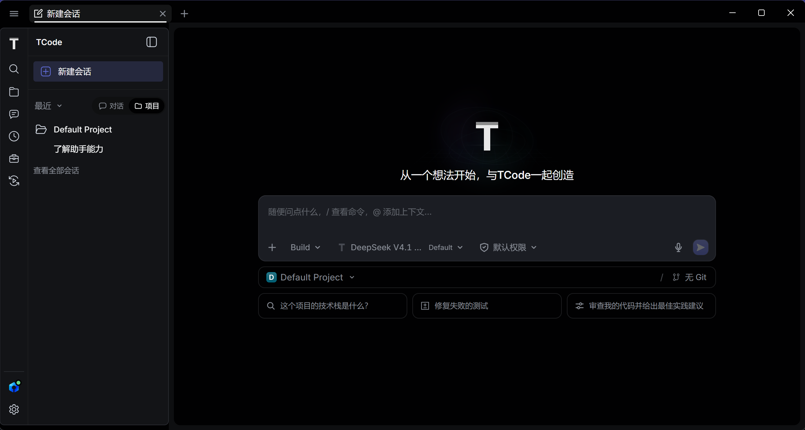

# TCode Desktop — Early Preview

<p align="center">
  
</p>

> **This is an early test build, not a finished product.** We're sharing it with a small group of developers to find out what breaks, what's confusing, and what actually helps. If you try it, please tell us — see [How to give feedback](#how-to-give-feedback).

**TCode is a graphical AI coding agent for Windows.** It takes on whole engineering tasks instead of suggesting the next line: it reads your project, plans a change, edits across files, runs commands, and checks the result. In the SWE-bench-Lite benchmark it resolved **71% of issues (Verified, #1 at the time of testing)** — but a benchmark score is not the same as working well on your codebase, which is exactly why we're here.

<p align="center">
  <a href="../../releases/latest"></a>
</p>

<p align="center">
  <code>Windows x64</code> · <code>Desktop GUI</code> · <code>Free to download during the preview</code>
</p>

<p align="center">
  
</p>

<!-- Optional later: a 30s screen recording showing cross-file bug location → edit → running tests. No marketing intro, just the work. -->

---

## What's in this build

We kept this section short on purpose — the useful way to understand TCode is to run it on a real task. A few things worth knowing before you start:

- **Task-level agent, not autocomplete.** Reads your project, plans a change across files, edits, runs commands, and verifies the outcome.
- **Everything stays visible.** File diffs, terminal activity, tool calls and progress live in one workspace. Sensitive operations ask for permission first (`allow once` / `always` / `deny`).
- **Bring your own model.** Configure a provider in Settings → Providers: a long list of model services, OpenAI-compatible endpoints, plus API-key and OAuth sign-in.
- **Works with GitHub and MCP.** A built-in read-only GitHub MCP Server can look at repos, issues, PRs and Actions; connectors include design tools like Figma.
- **Offline voice input.** Speech-to-text runs locally on your machine (models download on first use) — no audio leaves the device.
- **Extensible.** Skills, plugins, agents, scheduled tasks and an inbox are part of the app, alongside multiple UI languages.

---

## What we're looking for

We'd rather hear one concrete problem than ten compliments. Especially useful:

- Tasks where TCode **failed** or produced a wrong fix — the repo, the prompt, and what you expected
- Cross-file changes, legacy codebases, and unfamiliar project structures
- Model setup friction (providers, API keys, OpenAI-compatible endpoints)
- Windows-specific issues: install, SmartScreen, permissions, paths, encodings
- Anything in the UI that made you hesitate or guess

You don't need to write a polished report. A screenshot, a short description and your version number is plenty.

---

## Install

1. Download the latest test build from **[Releases](https://github.com/bjyiyuan/tcode-desktop-releases/releases/latest)** — `TCode-desktop-international-<version>-win-x64.exe`.
2. Run the installer. If Windows SmartScreen warns, choose **More info → Run anyway**.
3. Launch TCode, open the repository you want to work in, and connect a model in **Settings → Providers**.
4. Describe a task and watch it read → plan → edit → run → verify.

**Requirements:** Windows 10 or later (64-bit) · internet connection for model access · a model provider configured in Settings → Providers (your own API key or a supported account sign-in).

### Verify your download

Every release lists the SHA-256 digest of the installer:

```powershell
Get-FileHash .\TCode-desktop-international-<version>-win-x64.exe -Algorithm SHA256
```

Compare it with the digest shown next to the file on the release page.

---

## How to give feedback

**Please use GitHub Issues** — it's the channel we read first during this preview, and it's public, so other testers can confirm what you're seeing.

- **[Open a feedback issue](https://github.com/bjyiyuan/tcode-desktop-releases/issues/new/choose)** — a short form, takes about a minute
- Found a reproducible bug? Use the **Bug report** template instead
- A screenshot, a short description and your version number is plenty — rough notes are fine

> The in-app feedback dialog is not wired up in this build, so please don't rely on it.

**What we commit to:** every report gets a first response within 24 hours, and we'll tell you within 48 hours whether it's being fixed and in which version. Fixes are listed in the release notes with the issue number, so you can see what your report changed.

---

## Known limitations (we know, we're working on it)

- Windows only for now; macOS and Linux are not supported in this preview
- Model access depends on how you configure it in Settings → Providers; most configurations require an API key or an account sign-in
- The in-app feedback dialog may not deliver in this build — please use GitHub Issues instead
- Large repositories and very long tasks may be slow or hit context limits
- SmartScreen may warn because the installer is not yet signed by a widely trusted certificate
- The interface and wording are still rough — this is a test build

---

## FAQ

**Is it free?**
The desktop app is free to download during this preview. Model access is configured by you in Settings → Providers — bring your own API key or sign in with a supported account. Any model costs are set by that provider, not by us. We're still working out the billing details for this build; the in-app Settings are the source of truth.

**Where does my code go?**
Your code and prompts are sent to the model provider **you** configure. We do not use them for training. The app also collects anonymous usage metadata (never prompt contents) and includes a usage-statistics consent control in Settings. This repository contains installers only, no application source.

**Is the source code available?**
No. This repository distributes Windows installers only. The `Source code (zip)` / `Source code (tar.gz)` entries that GitHub adds to every release are snapshots of this download page, not the application. Use the `.exe` installer.

**Who's behind this?**
A small team building TCode. We're running this preview ourselves and reading every report.

**Will there be a stable release?**
That depends on what we learn here. We're not making promises until the preview tells us what to fix.

---

## About this repository

This repository is the download page for the TCode Desktop early preview. It hosts Windows installers only. Releases include SHA-256 digests so you can verify what you downloaded.

**License / terms:** the installer is proprietary software, distributed as a binary for evaluation. No source code is licensed or granted here. See [NOTICE.md](NOTICE.md).
