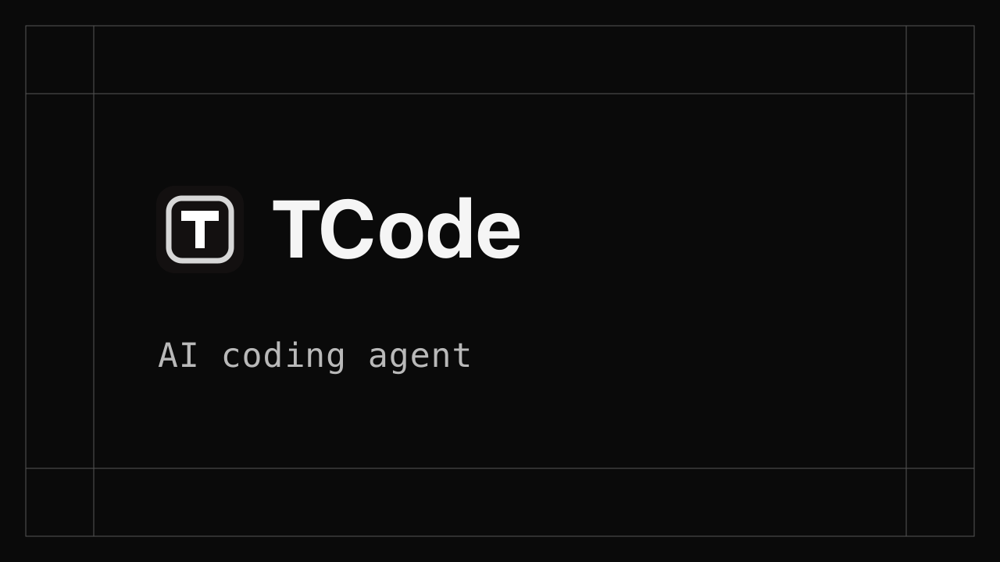

<p align="center">
  
</p>

<h1 align="center">TCode Desktop</h1>

<p align="center">
  <b>Open the desktop. Move every task forward.</b><br>
  A graphical AI coding agent for Windows.
</p>

<p align="center">
  <a href="../../releases/latest"></a>
</p>

<p align="center">
  <code>Windows x64</code> · <code>Desktop GUI</code>
</p>

---

<p align="center">
  
</p>

## Not just code completion — the whole task

From reading context, to editing files, to running commands and checking the outcome, TCode puts the entire coding workflow into one desktop workspace.

| | |
|---|---|
| **Task-level coding** | Understands project structure and code context, then implements, refactors, and fixes defects across files, verifying the result with real commands. |
| **Models and providers** | Works with mainstream model services and OpenAI-compatible endpoints, so the team can choose the model and context capabilities that fit its environment. |
| **Desktop workspace** | Task list, execution progress, and file changes in one place — no command memorization required to get started. |
| **Observable tool execution** | File edits, shell commands, and external tool calls stay visible, and sensitive operations ask for confirmation before proceeding. |

<p align="center">
  <code>read → plan → edit → run → verify → deliver</code>
</p>

---

## Install

1. Open the [latest release](../../releases/latest) and download **`TCode-desktop-international-<version>-win-x64.exe`**.
2. Run the installer and follow the prompts.
3. If Windows SmartScreen shows a warning, choose **More info** → **Run anyway**.
4. Launch TCode and pick the repository you want to work in.
5. Describe the task and let the agent read, plan, edit, and verify.

## Verify a download

Every release lists the SHA-256 digest of each installer. To check a file you downloaded:

```powershell
Get-FileHash .\TCode-desktop-international-<version>-win-x64.exe -Algorithm SHA256
```

Compare the output with the digest shown next to the file on the release page.

## Requirements

- Windows 10 or later, 64-bit
- An internet connection for model access

## About this repository

This repository is a download page for TCode Desktop. It hosts the Windows
installers only — there is no application source code here.

The `Source code (zip)` and `Source code (tar.gz)` entries that GitHub adds to
every release are automatic snapshots of this repository, which contains only
these files. Downloading them gives you no application code; use the `.exe`
installer instead.
